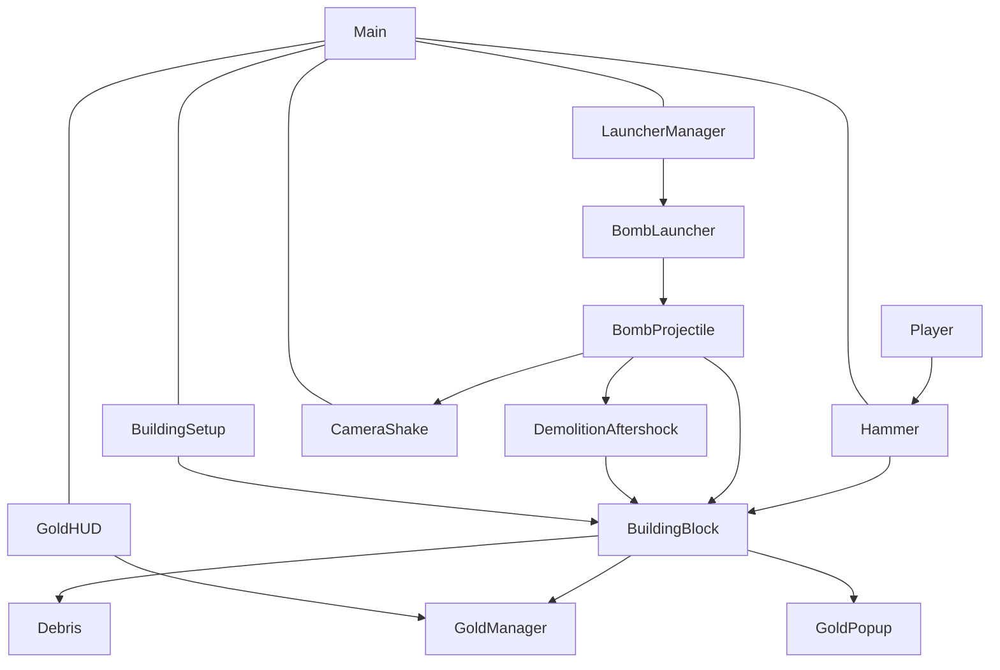

# MODULES.md —— 系统分工

> 每个模块回答三件事：职责 / 输入输出 / 依赖。随项目增长持续追加，不预先写空模块。

## 模块一览

| 模块 | 文件 | 职责 | 输入 / 输出 | 依赖 |
| --- | --- | --- | --- | --- |
| LauncherManager | [LauncherManager.gd](file:///e:/godotproject/boomame/scripts/LauncherManager.gd) | 管理 Main 中预置的炸弹炮台，按升级等级逐个"部署"激活，未解锁的隐藏+禁用 | 输入：UpgradeManager.launcher_upgraded(等级)；输出：激活/隐藏 BombLauncher、调用 play_deploy()/refresh_stats() | 依赖 BombLauncher、UpgradeManager |
| BombLauncher | [BombLauncher.gd](file:///e:/godotproject/boomame/scripts/BombLauncher.gd) | 单台自动炮台：独立冷却计时，炮管自瞄建筑区域并抛射炸弹 | 输入：冷却/伤害/半径（UpgradeManager）、aim_zone 横向瞄准偏好；输出：生成 BombProjectile | 依赖 BombProjectile、UpgradeManager |
| BombProjectile | [BombProjectile.gd](file:///e:/godotproject/boomame/scripts/BombProjectile.gd) | 抛射炸弹：飞行到目标后爆炸，伤害方块、施加冲击、播放特效与震屏 | 输入：damage / radius / bomb_gravity / 初速；输出：调用 BuildingBlock.launch/take_damage、CameraShake.shake | 依赖 BuildingBlock、CameraShake |
| BuildingSetup | [BuildingSetup.gd](file:///e:/godotproject/boomame/scripts/BuildingSetup.gd) | 运行时生成一栋无限层的楼：按楼层字符模板垂直叠放同屏 15 层方块，并按部件设置不同血量与配色；任意一层被全部砸碎后，其上方楼层整体塌落一层补位、楼顶补出新层，循环往复；提供 reset() 释放全部方块子节点并重新生成满楼（供"重新开始"） | 输入：无（自足生成）；输出：生成 BuildingBlock 节点、维护楼层列表；reset() 输入——由重置入口调用 | 依赖 BuildingBlock |
| BuildingBlock | [BuildingBlock.gd](file:///e:/godotproject/boomame/scripts/BuildingBlock.gd) | 方块本体：血量、受击碎裂、越界清理；提供 launch / take_damage 接口；碎裂时产出金币 | 输入：launch(方向,冲击)、take_damage(伤害)；输出：碎裂时生成视觉破碎碎屑、产出金币 | 依赖 Debris、GoldManager、GoldPopup |
| Debris | [Debris.gd](file:///e:/godotproject/boomame/scripts/Debris.gd) | 破碎碎屑（视觉特效）：向外飞散、缩小并淡出后自毁；不做物理掉落 | 输入：size / base_color；输出：无 | 无 |
| CameraShake | [CameraShake.gd](file:///e:/godotproject/boomame/scripts/CameraShake.gd) | 震屏：在 duration 内随机偏移 offset，随时间线性衰减 | 输入：shake(强度, 时长)；输出：无 | 无 |
| GoldManager | [GoldManager.gd](file:///e:/godotproject/boomame/scripts/GoldManager.gd) | 全局金币单例（Autoload）：累加总金币并广播 gold_changed 信号；维护生涯总统计（击破方块数 / 累计获取金币），供 SaveManager 独立存档、主菜单统计面板展示；提供 reset() 归零本局金币（供"重新开始"，不清生涯统计） | 输入：add_gold(数量)、register_destroyed()；输出：gold_changed(新总数)；经 restore_life_stats(blocks,gold) 恢复生涯统计 | 无 |
| UpgradeManager | [UpgradeManager.gd](file:///e:/godotproject/boomame/scripts/UpgradeManager.gd) | 全局升级管理器（Autoload）：统一管理锤子/金币/建筑/炸弹各升级项的等级与派生数值，实时供玩法读取；提供 reset() 复位全部等级与数值并广播变更（供"重新开始"） | 输入：各 upgrade_* 调用；输出：upgrades_changed、launcher_upgraded(new_level) | 无 |
| GoldPopup | [GoldPopup.gd](file:///e:/godotproject/boomame/scripts/GoldPopup.gd) / [GoldPopup.tscn](file:///e:/godotproject/boomame/scenes/GoldPopup.tscn) | 金币弹出提示（视觉特效）：在破坏点弹出 "+N 金币"，上飘淡出自毁；不做物理掉落，遵循破碎/粉碎取向；入树即加入 in_game_entity 组供重置清理 | 输入：amount；输出：无 | 无 |
| GoldHUD | [GoldHUD.gd](file:///e:/godotproject/boomame/scripts/GoldHUD.gd) | 金币 UI：左上角显示总金币，监听 GoldManager 实时刷新；顶部含"技能树 / 重新开始 / 返回主菜单"按钮；重新开始带"二次确认"框，确认后一次性重置金币/升级/楼体/场上残留并关闭技能树；返回主菜单带碎块转场切回 MainMenu | 输入：GoldManager.gold_changed；输出：更新金币文案、执行重置流程、执行返回主菜单转场 | 依赖 GoldManager、UpgradeManager、Building、DamageNumberLayer、ScreenTransition |
| Onboarding | [Onboarding.gd](file:///e:/godotproject/boomame/scripts/Onboarding.gd) | 动作驱动分步新手引导：玩家每完成一个关键动作才浮现下一条提示；含底部文字条、手型箭头、锤头亮圈、绕免按钮、每步轻提醒；完成/跳过写持久标记 `user://onboarding.cfg` | 输入：监听 Hammer.swung、GoldManager.gold_changed、UpgradeManager.launcher_upgraded、UpgradePanel.visibility_changed、BombProjectile.exploded；输出：引导 UI、持久标记 | 依赖 GoldManager、UpgradeManager、Hammer、UpgradePanel；只做单向监听不改写模块逻辑 |
| Main（场景） | [Main.tscn](file:///e:/godotproject/boomame/scenes/Main.tscn) | 组装一切：边界墙/地面、Building、LauncherManager（预置 BombLauncher 与 Spawn 点）、Hammer、MainCamera、GoldHUD、UILayer（UpgradePanel）；炮台与炮弹统一挂载在 Main 下 | 输入：无；输出：运行入口场景 | 组装所有模块 |
| ScreenTransition | [ScreenTransition.gd](file:///e:/godotproject/boomame/scripts/ScreenTransition.gd) | 场景切换过场（Autoload 常驻）：抓取当前画面切成矩形碎块，碎块带重力/旋转/爆散下落，延时切场后露出新场景，全部移出自动清理；过渡期拦截输入 | 输入：transition_to(目标场景路径)；输出：执行 change_scene、生成/清理碎块 | 依赖 SceneTree / Viewport（标准 API，无玩法模块依赖） |
| StatsPanel | [StatsPanel.gd](file:///e:/godotproject/boomame/scripts/StatsPanel.gd) | 主菜单"生涯统计"面板：全屏暗化 + 居中卡片，展示两个跨局累计数字（击破方块数量 / 总获取金币），只增不减；数据由 SaveManager 独立存档 `life_stats.cfg` | 输入：读取 GoldManager.stats_*；输出：主菜单可打开/关闭的统计面板 | 依赖 GoldManager、SaveManager |

## 依赖图

### 2026-10-13 场景协调表现层

| 模块 | 文件 | 职责 | 输入 / 输出 | 依赖 |
| --- | --- | --- | --- | --- |
| DemolitionContactShadow | `scripts/ContactShadow.gd` | 塔脚和履带下的两层像素阴影；炮台阴影固定在世界地面，随部署显现、随隐藏收起、随炮台释放 | `footprint`、`owner_visual`、`ground_y` / `reveal()` | PresentationProfile；不参与物理、伤害或奖励 |
| 场景调色 | `Presentation.scene_material(kind)` | 缓存背景、实心方块、玻璃、设备/碎屑、烟尘的共享 ShaderMaterial；最近邻采样与透明度保留 | `background`、`stone`、`glass`、`granite`、`granite_shard`、`equipment`、`dust` / 共享材质 | PresentationProfile、`assets/presentation/shaders/`；设置在新运行时读取 |

场景美术规则与验证入口见 [Scene_Art_Harmony.md](Scene_Art_Harmony.md)。方块外轮廓挂在自身 VisualLayer 下，随塌落移动和销毁，不维护固定楼体装饰。

### 2026-10-13 楼体 2.5D 表现

| 模块 | 文件 | 职责 | 输入 / 输出 | 依赖 |
| --- | --- | --- | --- | --- |
| DemolitionBuildingFacade | `scripts/BuildingFacade.gd` | 每块拥有的侧面、背面、顶部断面和立面柱线/窗台/薄楼板；仅在创建时绘制，无逐帧扫描 | 列号、墙/楼板颜色、玻璃与楼板标记、depth_only；无物理输出 | PresentationProfile；BuildingSetup 创建为 VisualLayer 子节点 |

完整说明见 [Building_Depth.md](Building_Depth.md)。真实玻璃重排到 2/3 与 8/9 列两个窗带，初始每墙层仍为 2～4 扇；补层窗带槽位以 0.75 概率出玻璃，整行期望仍为 3。所有材质 HP、金币、40×40 碰撞和逐列塌落算法保留。装饰侧面不增加可点击目标。

### 2026-10-13 Demo 节奏模块

| 模块 | 文件 | 职责 | 输入 / 输出 | 依赖 |
| --- | --- | --- | --- | --- |
| DemoProgress | [DemoProgress.gd](../scripts/DemoProgress.gd) | 每槽位四轮目标、真实试玩计时、累计产出/拆除、散射轮数、一次性完成记录 | `get_goal()`、`register_scatter_volley()`、`get_save_state()` / `restore_state()`；`completed` 信号 | ReincarnationManager、GoldManager、SaveManager；不持有单局或永久技能等级 |
| DemoSummary | [DemoSummary.gd](../scripts/DemoSummary.gd) | GoldHUD 下的完成弹窗；等待其他面板关闭，一次展示，继续/主菜单 | 读取已保存的完成快照；确认展示标记落盘 | DemoProgress、Presentation、GoldHUD |

`GoldManager` 登记每块拆除和实际产出；开局资金不计入；`BombLauncher` 生成整轮炮弹后登记一次散射。读档先恢复金币（触发 `run_reset`），再恢复 Demo 字段，避免覆盖已存散射计数。新游戏清空 Demo；重开/转生清空本轮计数但保留用时和完成快照。建筑依然不反向调用炮台。

### 2026-10-09 Demo 扩展模块

| 模块 | 文件 | 职责 | 输入 / 输出 | 依赖 |
| --- | --- | --- | --- | --- |
| DemolitionAftershock | [Aftershock.gd](../scripts/Aftershock.gd) | 场景所有的单次延迟伤害；0.45 秒后对原爆点结算，不生成连锁或新余震；属于 `in_game_entity`，随暂停冻结、随重开 / 切场清理 | 输入：伤害、半径、保底衰减；输出：伤害数字、蓝色爆炸、方块伤害 | BuildingBlock、UpgradeManager、BlastFx、DamageNumber；由 BombProjectile 创建 |
| Demo 节点目录 | `UpgradeManager.DEMO_NODES` | 10 个新增单局机制的效果、费用、前置、转生门槛与布局共享表 | 输入：金币购买 / 存档等级；输出：节点状态与实际效果 | ReincarnationManager；由技能树、武器和奖励结算读取 |
| 永久专精 | `ReincarnationManager.NODE_DEFS / specialization_steps` | 9 个新增永久专精的 RP 购买、门槛与统一效果增量 | 输入：RP / 永久等级；输出：运行时加值与提示 | SaveManager；不持有单局等级 |

GoldManager 新增 `run_reset` 信号，在重开或读档时清理锤击连击、有效锤数和每台炮台的齐射计数；合同以已经存档的拆除数量判定结算，不维护额外未持久化的进度。Building 系没有增加对炮台的反向调用。

## 协作约定

### 2026-10-13 破坏表现

| 模块 | 文件 | 职责 | 依赖 |
| --- | --- | --- | --- |
| DemolitionImpactFx | [ImpactFx.gd](../scripts/ImpactFx.gd) | 直接绘制短促锤击弧线与定向炮口火花；共用 hit 预算；随暂停冻结、自毁和重开清理 | Presentation；由 Hammer / BombLauncher 创建 |
| BlastFx / DustFx | `scripts/BlastFx.gd` / `scripts/DustFx.gd` | 像素爆炸搭配两层压力环、火星；粉尘扩散、上升、淡出 | Presentation；不参与命中计算 |
| 炮弹尾迹 | `scripts/BombProjectile.gd` | 固定上限的世界坐标历史点，直接绘制渐细尾迹 | PresentationProfile；不改变弹道 |

视觉参数和减少动态效果规则见 [SPEC.md](SPEC.md) 的表现优化参数表；渲染验证脚本为 `tools/motion_verify.gd`，必须在独立用户目录的副本运行。

- 炸弹炮台由 LauncherManager 生成并挂到 Main 下（世界对象）；抛射炮弹由 BombLauncher `get_tree().current_scene.add_child()` 挂到 Main 下；破碎碎屑由 BuildingBlock 挂到 `current_scene` 下；金币弹出提示也由 BuildingBlock 挂到 `current_scene` 下。
- 金币只累加数量 + 弹出提示，不做物理掉落（遵循"破坏反馈=破碎/粉碎"取向）。
- 避免循环依赖：BombProjectile → BuildingBlock → Debris 为单向链；Building 系不反向调用 LauncherManager / BombLauncher。
- 越界清理阈值（x<-100 / x>2020 / y>1200）在 BuildingBlock 各写一份；Debris 与 GoldPopup 为纯视觉特效，自毁由动画时长控制，不参与越界清理。
- 【重置清理】BombProjectile / Debris / GoldPopup / DamageNumber 入树时统一加入 `in_game_entity` 组；"重新开始"由 GoldHUD 触发：依次调用 GoldManager.reset()、UpgradeManager.reset()（内含 launcher_upgraded(0)，让 LauncherManager 隐藏全部炮台）、Building.reset()，再遍历 `in_game_entity` 组释放残留并清空 DamageNumberLayer，最后关闭技能树。重置只做调用、不深挖各模块内部数据。
